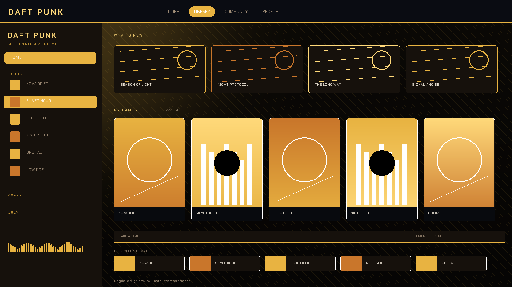

# Daft Punk Millennium

**An original retro-futuristic Steam theme for [Millennium](https://steambrew.app): mirrored chrome, visor light, seven distinct eras, and a CSS-only architecture.**



> Original artwork and CSS. Not affiliated with, endorsed by, or sponsored by Daft Punk or Valve. No album art, portraits, logos or commercial artwork are included.

---

## Status

| Area | Status |
| --- | --- |
| Source and metadata | Implemented |
| Static validation (JSON/CSS/SVG/TTF/assets) | Passed |
| Steam + Millennium runtime — library, game details, Friends/Chat, Settings, store shell | Runtime tested |
| All seven eras rendered in the live client | Visually inspected |
| Big Picture | Not yet verified |
| Full chat interaction matrix, DPI/multi-monitor, keyboard-only pass | Not yet verified |
| Community pages, store checkout | Not yet verified |

Detailed evidence: [VALIDATION_REPORT.md](VALIDATION_REPORT.md) and [AUDIT_REPORT.md](AUDIT_REPORT.md).

---

## What it is

A complete material system rather than a recolour:

- **Chrome and visor language** — brushed metal gradients, a 1px in-client window frame, a visor light line under the header, and clipped highlight edges.
- **Seven genuinely different eras** — each changes palette, panel material, geometry, typography and background motif:
  1. **Discovery Era** — warm gold on matte black, diagonal hatch, editorial uppercase.
  2. **Get Lucky Disco** — champagne and mirror-ball pink, dot matrix, soft italic display.
  3. **Cyan Visor** — cold laboratory cyan, scanlines, thin chrome edges.
  4. **Tron Legacy** — electric blue linework, a perspective grid floor, two-pixel geometry.
  5. **Neon Glow** — magenta and cyan tubes, pill controls, double neon edges.
  6. **Cosmic Voyager** — indigo space, static starfield, violet instrumentation.
  7. **Classic Discovery** — brushed aluminium, antique gold, matte and high-contrast.
- **Original assets** — twin-helmet mark, compact visor mark, visor light, grid and spectrum SVGs, plus generated preview artwork.
- **Bundled typography** — Chakra Petch Regular/SemiBold/Bold TTF (SIL OFL 1.1), with a system-font fallback option.
- **No JavaScript** — no polling, timers, random styling, fixed overlays or MutationObservers. Everything is CSS and documented Millennium configuration.

### In-client framing, not a fake OS titlebar

The frame and visor light are drawn **inside** the Steam web surface with `pointer-events: none`. The native Windows titlebar, dragging, resizing, snapping and multi-monitor behaviour are untouched. Millennium does not replace native OS chrome, and this theme does not claim to.

---

## Requirements

- Windows 10/11
- Steam desktop client with [Millennium](https://steambrew.app) installed
- A Millennium version that supports `Patches` and `Conditions` (verified here on Millennium Core 2.30.0; current releases should also work)
- Steam’s desktop UI (not the mobile app)

The theme was authored and tested against the Steam client with changelist **11146165** (CEF 126).

---

## Installation

1. Download `DaftPunk-Millennium-3.0.0.zip` from the releases page (or clone this repository).
2. Close Steam.
3. Extract the folder so that `skin.json` sits directly inside:

   ```
   %STEAM%\millennium\themes\DaftPunk-Millennium\skin.json
   ```

   On a default Windows install that is:

   ```
   C:\Program Files (x86)\Steam\millennium\themes\DaftPunk-Millennium\
   ```

4. Start Steam.
5. Open **Steam → Settings → Millennium → Themes**, select **Daft Punk Millennium**, and click **Use**.
6. Configure the era, motion, density, frame and typography from the theme’s settings tabs.

### Rollback

Close Steam, delete the `DaftPunk-Millennium` folder from `%STEAM%\millennium\themes`, and restart. Your previous theme selection remains in Millennium’s config and can be re-enabled from the Themes page.

---

## Options

Every option below loads a real CSS file and changes the rendered client. No inert controls.

| Option | Values | What it changes |
| --- | --- | --- |
| **Era** | Discovery Era (default), Get Lucky Disco, Cyan Visor, Tron Legacy, Neon Glow, Cosmic Voyager, Classic Discovery | Accent, chrome tint, sidebar/top-bar material, radius, display type, background motif |
| **Motion** | Still, Subtle, Cinematic (default), Overdrive | Transition durations, hover lift, logo/visor animation. OS reduced-motion always wins. |
| **Density** | Compact, Standard (default), Spacious | Library stage padding and panel padding |
| **Visor Frame** | yes (default), no | The in-client chrome frame and visor light |
| **Typography** | Helmet Display (default), System Clean | Chakra Petch TTF files or Steam’s Motiva Sans stack |

Changing an option does not leave stale classes or duplicate styles: each choice is a self-contained stylesheet of tokens and scoped rules, and Millennium injects only the selected file.

---

## Architecture

`skin.json` uses a documented **custom `Patches` list** rather than `UseDefaultPatches`. This is deliberate:

- It reproduces the default Steam window targets (main UI, overlays, notifications, menus, dialogs, Friends, Big Picture).
- It adds store and community browser targets so those surfaces receive a coherent treatment.
- It does **not** combine `UseDefaultPatches` with `Patches` or `Steam-WebKit`, which the Millennium docs warn against.

```
DaftPunk-Millennium/
├── skin.json                  # metadata, patches, seven eras, five option groups
├── libraryroot.custom.css     # main-window material system
├── friends.custom.css         # Friends List + detached chat windows
├── bigpicture.custom.css      # Big Picture token remap
├── webkit.css                 # store/community browser views
├── themes/                    # seven era stylesheets
├── options/                   # motion, density, frame, typography
├── assets/
│   ├── fonts/                 # Chakra Petch TTF + OFL
│   ├── *.svg                  # original marks and motifs
│   └── previews/              # original design preview artwork
├── docs/DESIGN_RESEARCH.md
├── AUDIT_REPORT.md
└── VALIDATION_REPORT.md
```

### Selector policy

Selectors were checked against the live Steam DOM, including `.TopBar`, `.LibraryHome`, `.LibraryItemBox`, `.GameListEntryContainer`, `.PlayBar`, `.AppDetailsSection`, `.friendsui-container`, `.chatWindow`, `.TitleBar`, `.DialogButton`, `.contextMenuItem`, and the `MillenniumWindow_*` classes. Hashed Steam classes are used only where a stable semantic class is unavailable, and every hashed selector that remains was observed in the installed client.

No `.steamui_*` guesses, no global `* { color: … }` recolouring, no universal SVG fills overrides.

---

## Compatibility and known limits

- **Steam updates can rename generated classes.** Semantic classes are preferred, but Valve can still change the desktop DOM. Report a broken surface with the Steam changelist and a screenshot.
- **Native Windows titlebar is not replaceable by Millennium.** The theme draws an in-client frame only.
- **Big Picture** receives a token/typography remap, not a full layout redesign. It has not been runtime-verified here.
- **Store/community pages** ship their own CSS after theme injection, so the theme uses raised-specificity rules and only changes colour, surfaces and typography. Checkout flows and prices keep their native hierarchy.
- **Reduced motion** is respected in CSS and in the Overdrive option.
- **Millennium version differences**: verified against Millennium Core 2.30.0. Newer 3.x releases may change settings rendering or update handling; the theme uses documented `Patches`, `Conditions` and vanilla CSS only.

---

## Development checks

From the workspace root:

```powershell
python _tools\validate_theme.py DaftPunk-Millennium
```

The validator checks `skin.json`, every patch/condition target, CSS parse errors, missing `url()` assets, SVG XML, TTF headers/metadata, and reports universal selectors and `.steamui_*` guesses.

Runtime verification used the installed Steam client with `-cef-enable-debugging` and Millennium’s own theme/condition loading. It is not repeated automatically by this repository.

---

## License and credits

- Theme code and original artwork: **MIT** — see [LICENSE](LICENSE).
- Chakra Petch: **SIL Open Font License 1.1** — see `assets/fonts/OFL.txt`.
- Built for [Millennium](https://github.com/SteamClientHomebrew/Millennium). Millennium is MIT-licensed; no Millennium code is bundled.
- Design research references are listed in [docs/DESIGN_RESEARCH.md](docs/DESIGN_RESEARCH.md). No third-party artwork is shipped.

Daft Punk is a trademark of its respective owners. This is an unofficial fan-made visual theme.
